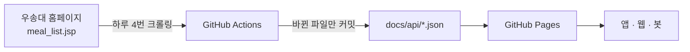

<div align="center">

# 🍱 wsu-meal-api

**우송대학교 학식 정보를 JSON으로 제공하는 무료 공개 API**

[](https://github.com/sangukjeon/wsu-meal-api/actions/workflows/update.yml)
[](https://sangukjeon.github.io/wsu-meal-api/api/today.json)


</div>

서버나 DB 없이 동작합니다. GitHub Actions가 하루 네 번 학교 홈페이지에서 식단을 가져와 JSON 파일로 저장하고, GitHub Pages가 그 파일을 제공합니다.

## 빠른 시작

```js
const res = await fetch("https://sangukjeon.github.io/wsu-meal-api/api/today.json");
const { date, data } = await res.json();

console.log(data["학생식당(서캠)"]["천원의아침밥"]);
// ["간장찜닭", "쌀밥", "얼큰고추장찌개", ...]
```

인증이 필요 없고 CORS가 열려 있어서, 브라우저에서도 바로 호출할 수 있습니다.

## 엔드포인트

**기본 주소** `https://sangukjeon.github.io/wsu-meal-api/api/`

| 경로 | 설명 |
|---|---|
| [`today.json`](https://sangukjeon.github.io/wsu-meal-api/api/today.json) | 오늘(KST) 식단 |
| [`week.json`](https://sangukjeon.github.io/wsu-meal-api/api/week.json) | 이번 주 식단 (월~일) |
| `date/{YYYY-MM-DD}.json` | 특정 날짜 식단. 지난 날짜도 보관됩니다 |
| [`cafeterias.json`](https://sangukjeon.github.io/wsu-meal-api/api/cafeterias.json) | 식당 목록 |
| [`index.json`](https://sangukjeon.github.io/wsu-meal-api/api/index.json) | 조회 가능한 날짜 목록 |

## 응답 형식

```jsonc
// GET /api/date/2026-11-03.json
{
  "updatedAt": "2026-11-03T12:53:08.063Z",
  "date": "2026-11-03",
  "data": {
    "학생식당(서캠)": {
      "천원의아침밥": ["간장찜닭", "쌀밥", "얼큰고추장찌개"],
      "교직원": ["고구마치즈돈까스", "쌀밥", "크림스프"]
    },
    "국제기숙사": {
      "조식": ["..."], "중식": ["..."], "석식": ["..."]
    }
  }
}
```

| 필드 | 설명 |
|---|---|
| `updatedAt` | 파일 **내용이 마지막으로 바뀐** 시각 (UTC) |
| `date` | 식단 날짜 |
| `data` | `{ 식당: { 코너: [메뉴] } }`. 그날 운영하지 않는 식당은 `null`입니다 |

`week.json`은 `{ start, end, data: { 날짜: { 식당: ... } } }` 형태입니다.

### 식당과 코너

| 식당 | 코너 |
|---|---|
| 학생식당(서캠) | 천원의아침밥, 소담상, 교직원 등 (주마다 다름) |
| 학생식당(동캠) | 천원의아침밥, 한식, 푸드코트 |
| 국제기숙사 | 조식, 중식, 석식 |
| 청운숙기숙사 | 조식, 중식, 석식 |
| 기숙사(동캠) | 조식, 중식, 석식 |

코너 이름은 학교 홈페이지 표기를 그대로 따르고, 메뉴가 없는 코너는 빠집니다.

## 동작 방식



- **갱신 시각**: 매일 00:10, 08:17, 11:17, 14:17 (KST). 지금 바로 갱신하려면 Actions 탭에서 `식단 업데이트`를 수동으로 실행하세요.
- **변경 감지**: 내용이 같으면 파일을 다시 쓰지 않아서, 식단이 실제로 바뀌었을 때만 커밋이 생깁니다.
- **기록 보관**: 날짜별 파일을 지우지 않기 때문에 지난 식단이 계속 쌓입니다.
- **실패 처리**: 크롤링이 실패하면 기존 파일을 그대로 두고 워크플로만 실패합니다. 이때 GitHub이 알림 메일을 보냅니다.

## 프로젝트 구조

```
├── crawler.mjs                  # 학교 홈페이지에서 식단 HTML을 가져와 파싱
├── build.mjs                    # 날짜별 JSON 생성 (내용이 바뀐 파일만 갱신)
├── docs/api/                    # 공개되는 JSON 파일
└── .github/workflows/update.yml # 예약 실행 및 커밋
```

로컬에서 실행하려면 Node 18 이상이 필요하고, 설치할 패키지는 없습니다.

```bash
npm run build
```

## 알아 두면 좋은 점

- **`today.json` 갱신 지연**: GitHub 예약 실행은 늦어질 수 있어서, 자정 직후에는 `today.json`이 전날 데이터일 수 있습니다. 날짜가 정확해야 하면 `date/{오늘}.json`을 사용하세요.
- **연도 처리**: 학교 홈페이지는 `11.03`처럼 연도 없이 날짜를 표시합니다. 오늘과 가장 가까운 연도로 변환하므로 연말연초에도 날짜가 맞습니다.
- **예약 실행 중지**: 공개 저장소는 60일 동안 활동이 없으면 예약 실행이 꺼질 수 있습니다. 방학 뒤에 갱신이 멈췄다면 Actions 탭에서 다시 켜세요.

<details>
<summary><b>포크해서 직접 배포하기</b></summary>

1. 저장소를 포크하고, **Actions** 탭에서 워크플로를 켭니다. 포크한 저장소는 예약 실행이 기본으로 꺼져 있습니다.
2. **Settings → Pages**에서 `Deploy from a branch`를 고르고, 브랜치는 `main`, 폴더는 `/docs`로 지정합니다.
3. **Actions** 탭에서 `식단 업데이트`를 한 번 수동으로 실행합니다.

API 주소는 `https://<아이디>.github.io/<저장소 이름>/api/`가 됩니다.

</details>

---

<sub>우송대학교의 공식 서비스가 아닙니다. 식단 정보의 출처는 [우송대학교 홈페이지 학생식당 안내](https://www.wsu.ac.kr/page/index.jsp?code=campus0806)이며, 실제 제공 메뉴와 다를 수 있습니다.</sub>
